# TP2 · Grupo 12 · Eximia Code
## Descripción
**Contexto académico:** IFTS 29 · Tecnicatura Superior en Desarrollo de Software · Desarrollo de Sistemas Web (Front End) · 2.º A · Docente: Luciano Martínez · 2026.

**Eximia Code** es el equipo ficticio de desarrollo de software del Grupo 12, especializado en soluciones de **logística inteligente B2B**, optimización de rutas, cadena de frío y trazabilidad. Este TP2 continúa el proyecto iniciado en el [TP1 del Grupo 12](https://github.com/fiorellaalarcon/tp1-grupo12)y lo transforma en una aplicación de una sola página (SPA) desarrollada con **React 19**, **React Router 8** y **Vite 8**.

La aplicación se organiza mediante una sidebar compartida —que en dispositivos móviles se convierte en un panel desplegable— e incluye:

- **Portada:** presentación del equipo, panel visual y  demo/Simulación interactiva de optimización de rutas.
- **Equipo y perfiles:** cinco perfiles construidos con un componente reutilizable y datos de `members.json`. Incluyen habilidades, películas, discos favoritos e interacciones asociadas a cada rol.
- **Recursos JSON:** catálogo local de 24 registros ficticios de empresas y servicios logísticos, con búsqueda, filtros y detalle desplegable.
- **API pública:** consulta del clima de seis ciudades argentinas mediante Open-Meteo, con estados de carga, error y opciones para actualizar o reintentar.
- **Árbol de renderizado:** representación expandible de la jerarquía de componentes.
- **Bitácora:** registros del proceso de trabajo del TP1 y TP2, con filtros y desplegables.
- **Contacto:** formulario único con validación y envío AJAX; permite identificar al integrante destinatario cuando se accede desde un perfil.

Las rutas principales son `/`, `/equipo`, `/equipo/:slug`, `/recursos`, `/api`, `/arbol`, `/bitacora` y `/contacto`. También se incluye una página 404 propia. Las rutas internas pueden abrirse y recargarse directamente en el sitio publicado.

## Sitio publicado

- **Vercel:** [https://tp2-grupo-12.vercel.app/](https://tp2-grupo-12.vercel.app/)
- **Repositorio:** [https://github.com/fiorellaalarcon/tp2-grupo12](https://github.com/fiorellaalarcon/tp2-grupo12)
- **TP1 del Grupo 12:** [https://github.com/fiorellaalarcon/tp1-grupo12](https://github.com/fiorellaalarcon/tp1-grupo12)

## Integrantes

| Nombre y apellido | Perfil de GitHub |
| --- | --- |
| Fiorella Alarcón | [https://github.com/fiorellaalarcon/](https://github.com/fiorellaalarcon/) |
| Axel Alva | [https://github.com/axelalva2023/](https://github.com/axelalva2023/) |
| Malena Jasque | [https://github.com/malenajasque/](https://github.com/malenajasque/) |
| Javier Churquina | [https://github.com/Freddy1537/](https://github.com/Freddy1537/) |
| Selene Pais | [https://github.com/Selepais/](https://github.com/Selepais/) |

## Índice

- [Descripción](#descripción)
- [Sitio publicado](#sitio-publicado)
- [Integrantes](#integrantes)
- [Tecnologías y servicios](#tecnologías-y-servicios)
- [Instalación y ejecución](#instalación-y-ejecución)
- [Estructura del proyecto](#estructura-del-proyecto)
- [Rutas](#rutas)
- [Identidad visual](#identidad-visual)
- [Accesibilidad y responsive](#accesibilidad-y-responsive)
- [Interacciones y funciones](#interacciones-y-funciones)
- [De TP1 a TP2](#de-tp1-a-tp2)
- [Capturas](#capturas)
- [Uso de IA](#uso-de-ia)
- [Responsabilidades](#responsabilidades)
- [Uso de IA por integrante](#uso-de-ia-por-integrante)
- [Revisión humana y autoría](#revisión-humana-y-autoría)
- [Checklist de los 15 criterios](#checklist-de-los-15-criterios)
- [Colaboración](#colaboración)

## Tecnologías y servicios

### Tecnologías principales

| Tecnología | Versión | Uso |
| --- | --- | --- |
| React / React DOM | 19.3.1 | Interfaz basada en componentes, props y hooks. |
| React Router | 8.5.1 | Navegación, rutas dinámicas y carga diferida. |
| Vite | 8.3.5 | Servidor de desarrollo y empaquetado. |
| `@vitejs/plugin-react` | 6.1.2 | Integración de React con Vite. |
| Oxlint | 1.90.0 | Análisis estático mediante `npm run lint`. |
| Node.js | ≥ 22.22.0 | Entorno de ejecución, según `.nvmrc` y `engines`. |
| JavaScript moderno (ECMAScript, módulos ES) - JSX | — | Lógica y estructura de los componentes. |
| CSS puro | — | Variables, temas claro y oscuro y diseño responsive. |
| JSON local | — | Datos de integrantes, catálogo, bitácora y árbol. |

Las versiones están declaradas en `package.json` y son compatibles entre sí.

### Servicios y recursos externos

| Servicio | Uso |
| --- | --- |
| [Vercel](https://vercel.com/) | Publicación de la aplicación; `vercel.json` configura las rutas de la SPA. |
| [Open-Meteo](https://open-meteo.com/) | API pública sin clave para consultar datos meteorológicos de seis ciudades argentinas. |
| [API REST de GitHub](https://docs.github.com/es/rest) | Consulta del historial de commits desde la bitácora. |
| [FormSubmit](https://formsubmit.co/) | Recepción del formulario mediante `fetch` (AJAX). |
| [Spotify Embeds](https://developer.spotify.com/documentation/embeds) | Reproductores de discos favoritos cargados bajo demanda. |
| [Google Fonts](https://fonts.google.com/) | Tipografías de la identidad visual. |
| [Devicon](https://devicon.dev/) | Iconografía de tecnologías y habilidades. |

## Instalación y ejecución

**Requisitos:** Node.js 22.22.0 o superior, npm y Git.

```bash
git clone https://github.com/fiorellaalarcon/tp2-grupo12.git
cd tp2-grupo12

npm install
npm run dev
npm run lint
npm run build
npm run preview
```

| Comando | Función |
| --- | --- |
| `npm install` | Instala las dependencias (necesario una vez después de clonar). |
| `npm run dev` | Inicia el servidor de desarrollo en `http://localhost:5173`. |
| `npm run lint` | Ejecuta el análisis estático con Oxlint. |
| `npm run build` | Genera la versión optimizada en `dist/`. |
| `npm run preview` | Permite probar localmente la compilación de producción. |

## Estructura del proyecto

```text
tp2-grupo12/
├── docs/
│   ├── capturas/          # Capturas utilizadas en este README
│   ├── IA-PROMPTS.md      # Prompts de generación de imágenes
│   └── PLAN-COMMITS.md    # Ramas, commits y Pull Requests
├── public/img/            # Logo, panel, avatares, pósters y portadas
├── src/
│   ├── components/        # Componentes reutilizables
│   ├── context/           # ThemeContext
│   ├── data/              # members.json, catalogo.json, bitacora.json, tree.json
│   ├── hooks/             # Hooks personalizados
│   ├── layouts/           # RootLayout
│   ├── pages/             # Páginas de la aplicación
│   ├── styles/            # Hojas CSS organizadas por responsabilidad
│   ├── App.jsx            # Tema y configuración de rutas
│   └── main.jsx           # Punto de entrada
├── index.html
├── package.json
├── package-lock.json
├── vercel.json
└── vite.config.js
```

La jerarquía completa de componentes se puede consultar en **Árbol de renderizado** (`/arbol`).

## Rutas

| Ruta | Contenido |
| --- | --- |
| `/` | Portada, panel visual, demo, presentación del equipo y recorrido de la aplicación. |
| `/equipo` | Presentación de los integrantes y responsabilidades. |
| `/equipo/:slug` | Perfil reutilizable de cada integrante (`fiorella`, `axel`, `malena`, `javier`, `selene`). |
| `/recursos` | Catálogo JSON de 24 registros con búsqueda y filtros. |
| `/api` | Consulta meteorológica mediante Open-Meteo. |
| `/arbol` | Árbol de renderizado expandible y contraíble. |
| `/bitacora` | Registros del proceso de trabajo con filtros y desplegables funcionales. |
| `/contacto` | Formulario; admite `?para=slug` para identificar al destinatario. |
| `*` | Página 404. |

## Identidad visual

La identidad de Eximia Code combina tecnología y logística mediante una paleta de azul profundo, verde petróleo, azul y turquesa. Se conserva la línea visual desarrollada en el TP1 y se adapta a la arquitectura de componentes de React.

Los colores se definen mediante variables CSS en `src/styles/01-variables.css`, con tema claro y oscuro. El tema respeta la elección guardada por la persona, luego la preferencia del sistema y, por defecto, el modo claro.

### Paleta de colores

| Uso | Tema claro | Tema oscuro |
| --- | --- | --- |
| Fondo principal | `#FFFFFF` | `#0B132B` |
| Fondo secundario | `#F4F7F6` | `#111C3D` |
| Superficies | `#E3EBE8` | `#1C2541` |
| Texto principal | `#070D1F` | `#FFFFFF` |
| Texto secundario | `#1E293B` | `#E4E9F0` |
| Bordes | `#3A506B` | `#6B829B` |
| Íconos | `#005F73` | `#90E0EF` |
| Acento principal | `#00684D` | `#06D6A0` |
| Acento secundario | `#005A80` | `#48CAE4` |
| Anillo de foco | `#D9381E` | `#FFB703` |
| Error | `#B42318` | `#FF9B91` |

### Tipografías e iconografía

| Recurso | Uso |
| --- | --- |
| Orbitron | Marca y títulos `h1`. |
| Space Grotesk | Encabezados secundarios. |
| IBM Plex Sans | Texto general. |
| SVG propios | Íconos de interfaz y logo de Figma multicolor. |
| Devicon | Íconos de tecnologías y habilidades. |

### Imágenes

El logo, el panel y los avatares fueron generados con IA y luego seleccionados y editados por el equipo para mantener coherencia con la paleta y con ambos temas. Los pósters de películas y las portadas de discos son las imágenes originales de cada obra y se utilizan en formato WebP.

## Accesibilidad y responsive

- La navegación identifica la página activa mediante `aria-current="page"`.
- En pantallas de hasta 900 px, la sidebar funciona como panel desplegable e incluye `aria-expanded`, cierre con `Esc`, gestión del foco y fondo inerte.
- Hay un enlace para saltar al contenido principal y el foco se traslada al título en cada cambio de ruta.
- Los formularios utilizan etiquetas, validación por campo, `aria-invalid` y mensajes asociados mediante `aria-describedby`.
- Los estilos contemplan `prefers-reduced-motion`, `prefers-contrast`, `forced-colors` y `prefers-color-scheme`.
- El diseño se adapta a distintos anchos de pantalla, con especial atención a 400, 900 y 1200 px, adaptable a distintos dispositivos sin desplazamiento horizontal.
- Las páginas y las imágenes utilizan carga diferida cuando corresponde; Spotify se incorpora bajo demanda y se detiene al cambiar de página.

## Interacciones y funciones

### Portada

| Interacción | Componente o función | Descripción |
| --- | --- | --- |
| Optimización de ruta | `RouteDemo` | Permite seleccionar zona y cantidad de entregas; compara el recorrido inicial con el optimizado y presenta el ahorro estimado. |
| Barra de anclas | `AnchorBar` y `useScrollSpy` | Permite saltar entre secciones y resalta la sección visible. |
| Perfil aleatorio | `RandomProfile` | Selecciona un integrante y enlaza con su perfil (también disponible en `/equipo`). |
| Recorré el proyecto | Tarjetas de acceso | Enlazan con Recursos JSON, API pública, Árbol de renderizado y Bitácora. |
| Tema claro/oscuro | `ThemeContext` y `ThemeToggle` | Gestiona el tema de la interfaz y lo guarda en `localStorage`. |

### Perfiles (`/equipo/:slug`)

La página `Profile` utiliza `members.json` para mostrar la información de cada integrante mediante una estructura reutilizable.

| Interacción | Componente | Descripción |
| --- | --- | --- |
| Interacción de rol | `RoleDemo` | Muestra mensajes asociados al rol de cada integrante. |
| Habilidades | `SkillCard` | Presenta habilidades e íconos de tecnologías. |
| Películas favoritas | `MovieCard` | Muestra pósters con enlaces de búsqueda de películas. |
| Discos favoritos | `AlbumCard` | Presenta un efecto de vinilo y carga Spotify al pulsar reproducir. |
| Navegación entre perfiles | `ProfileNav` | Permite ir al perfil anterior, volver al inicio o avanzar al siguiente. |
| Resto del equipo | `RestCard` | Muestra las otras cuatro tarjetas para continuar explorando. |
| Contacto | `/contacto?para=slug` | Identifica al integrante destinatario. |

### Otras secciones

| Sección | Funcionalidad |
| --- | --- |
| Recursos JSON | Búsqueda, filtros por tipo y país, detalle desplegable, mensaje sin resultados y restablecimiento. |
| API pública | Open-Meteo con estados de carga, error y éxito, actualización y reintento. |
| Árbol de renderizado | Expansión y contracción de nodos, individual o de todo el árbol. |
| Bitácora | Registros con filtros y desplegables; consulta del historial de commits a pedido. |
| Contacto | Formulario único con validación y envío AJAX. |
| Menú móvil | Panel desplegable con controles de teclado y gestión del foco. |

## De TP1 a TP2

| Aspecto | TP1 | TP2 |
| --- | --- | --- |
| Tecnología principal | HTML, CSS y JavaScript. | React, React Router y Vite. |
| Navegación | Siete páginas HTML independientes, con recarga completa. | SPA con rutas y navegación compartida. |
| Perfiles | Cinco páginas con estructura repetida. | Componente reutilizable alimentado por `members.json`. |
| Interacciones | Doce archivos JavaScript asociados a páginas y módulos. | Componentes y hooks de React. |
| Formularios | Seis formularios separados. | Formulario único con identificación del destinatario. |
| Datos | Contenido incorporado en las páginas. | Datos organizados en archivos JSON locales. |
| Bitácora | Página documental estática. | Registros con filtros y desplegables. |

Se conserva la identidad visual del TP1 y se reorganiza la implementación para trabajar con componentes reutilizables, rutas, datos locales y estados de interfaz propios de React.

## Capturas

Cada captura corresponde a una pantalla real del sitio publicado. Los archivos están en `docs/capturas/`.

### 1. Portada

- **Ruta:** `/`
- **Archivo:** `docs/capturas/tp2-01-portada.webp`
- **Descripción:** presentación de Eximia Code con el panel visual a la derecha, la demo interactiva «Optimizar ruta», los botones de contacto y equipo, las tarjetas de los integrantes y el selector de perfil al azar.

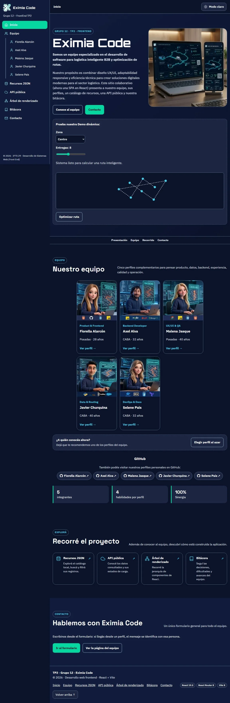

### 2. Perfiles de los integrantes

Cada captura muestra el perfil individual de un integrante, con la estructura reutilizable de la página, la sidebar compartida, la foto, los datos personales, el rol, el enlace a GitHub, el botón de contacto, la interacción de rol como ejemplo y la navegación entre secciones.

#### 2.1. Perfil de Fiorella Alarcón

- **Ruta:** `/equipo/fiorella`
- **Archivo:** `docs/capturas/tp2-02-perfil-fiorella.webp`
- **Descripción:** perfil individual de Fiorella Alarcón con sus datos, rol, enlaces e interacciones.

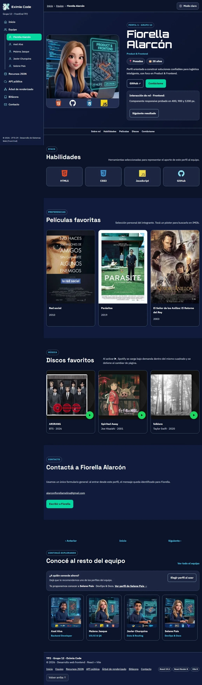

#### 2.2. Perfil de Axel Alva

- **Ruta:** `/equipo/axel`
- **Archivo:** `docs/capturas/tp2-02-perfil-axel.webp`
- **Descripción:** perfil individual de Axel Alva con sus datos, rol, enlaces e interacciones.

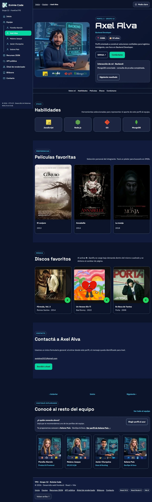

#### 2.3. Perfil de Malena Jasque

- **Ruta:** `/equipo/malena`
- **Archivo:** `docs/capturas/tp2-02-perfil-malena.webp`
- **Descripción:** perfil individual de Malena Jasque con sus datos, rol, enlaces e interacciones.

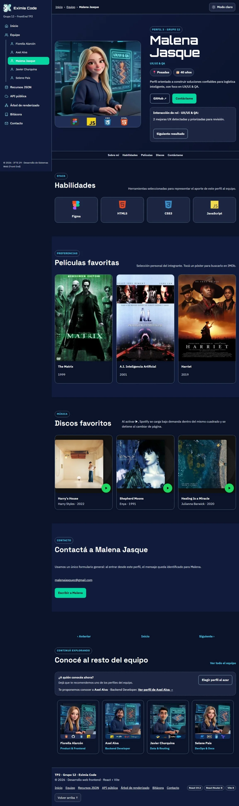

#### 2.4. Perfil de Javier Churquina

- **Ruta:** `/equipo/javier`
- **Archivo:** `docs/capturas/tp2-02-perfil-javier.webp`
- **Descripción:** perfil individual de Javier Churquina con sus datos, rol, enlaces e interacciones.

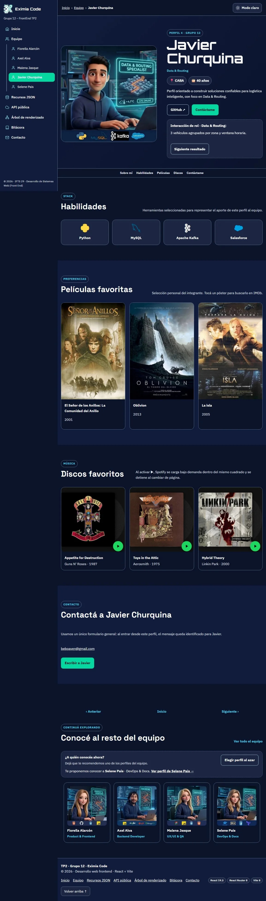

#### 2.5. Perfil de Selene Pais

- **Ruta:** `/equipo/selene`
- **Archivo:** `docs/capturas/tp2-02-perfil-selene.webp`
- **Descripción:** perfil individual de Selene Pais con sus datos, rol, enlaces e interacciones.

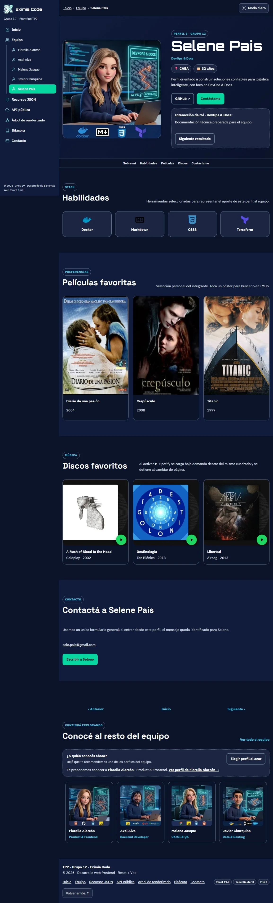

### 3. Menú móvil

- **Ruta:** cualquiera, en pantallas de hasta 900 px
- **Archivo:** `docs/capturas/tp2-03-menu-movil.webp`
- **Descripción:** la sidebar convertida en panel desplegable, con la identidad del equipo, los enlaces, los perfiles y la página activa marcada.

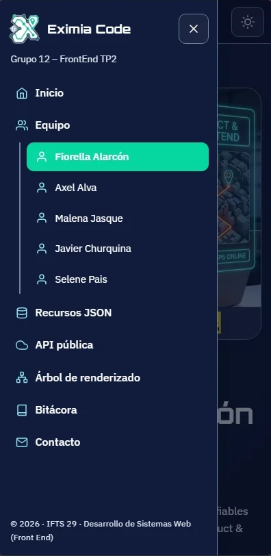

### 4. Recursos JSON

- **Ruta:** `/recursos`
- **Archivo:** `docs/capturas/tp2-04-catalogo.webp`
- **Descripción:** catálogo de 24 clientes ficticios con búsqueda por texto, filtros por tipo y país, botón para restablecer y tarjetas con detalle desplegable.

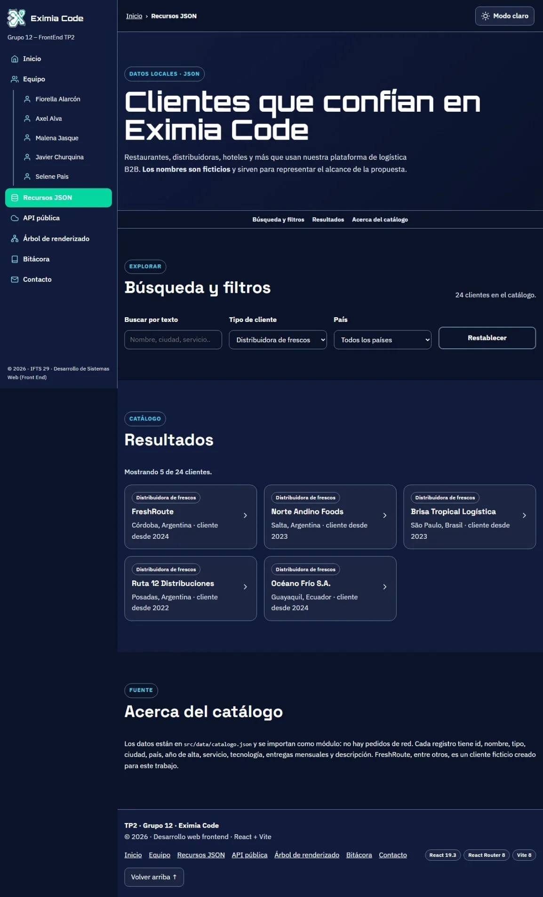

### 5. API pública

- **Ruta:** `/api`
- **Archivo:** `docs/capturas/tp2-05-api.webp`
- **Descripción:** clima actual de seis ciudades consultado a Open-Meteo, con nivel de riesgo para la cadena de frío y botones para actualizar o reintentar.

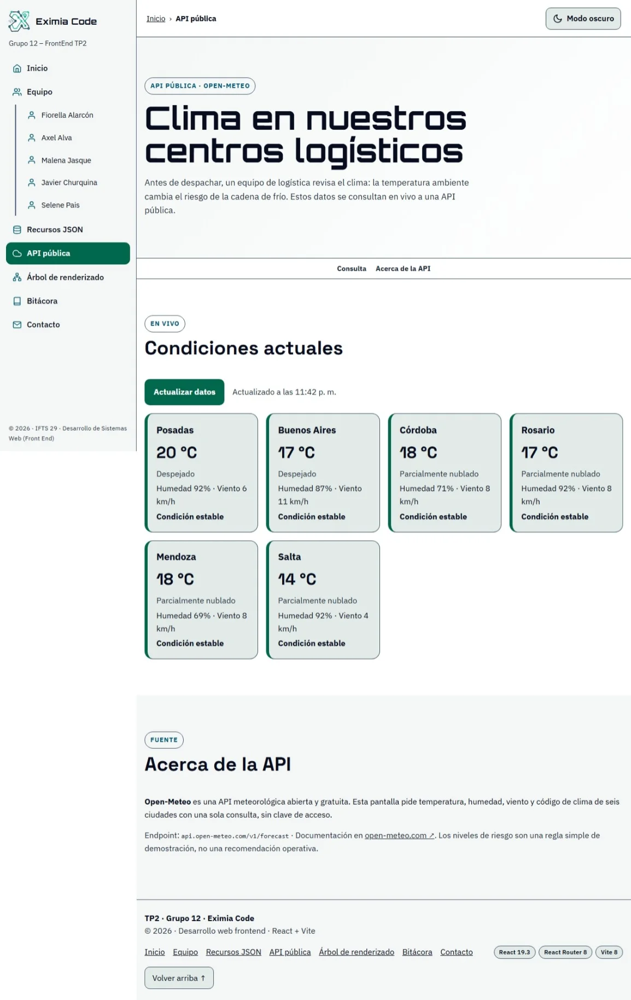

### 6. Árbol de renderizado

- **Ruta:** `/arbol`
- **Archivo:** `docs/capturas/tp2-06-arbol.webp`
- **Descripción:** jerarquía de componentes de la aplicación, con archivo, props y hooks de cada nodo, y controles para expandir y contraer.

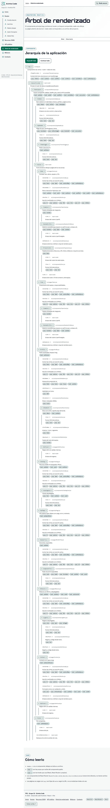

### 7. Bitácora

- **Ruta:** `/bitacora`
- **Archivo:** `docs/capturas/tp2-07-bitacora.webp`
- **Descripción:** registros del proceso del TP1 y TP2 con búsqueda, filtros por etapa, tipo y etiqueta, y contenidos desplegables.

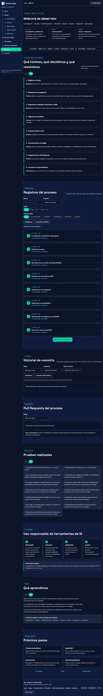

### 8. Página no encontrada

- **Ruta:** `*` (cualquier ruta inexistente)
- **Archivo:** `docs/capturas/tp2-08-pagina-no-encontrada.webp`
- **Descripción:** página 404 propia, dentro del mismo layout, con botones para volver al inicio, al equipo o al contacto.

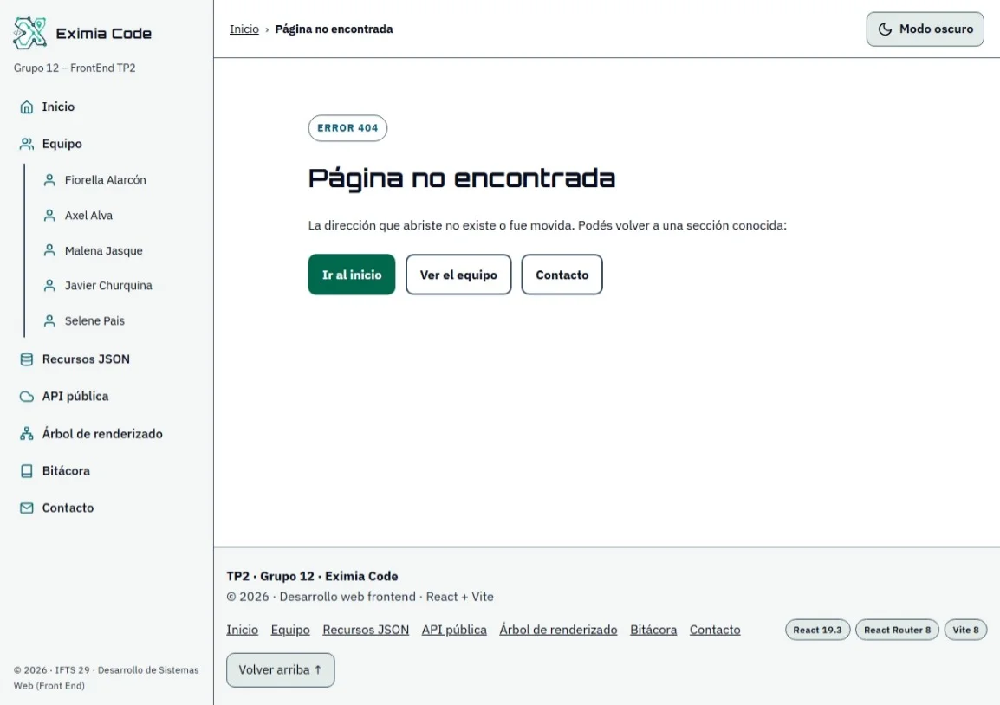


## Responsabilidades

| Integrante | Responsabilidad en el proyecto |
| --- | --- |
| Fiorella Alarcón | **Product & Frontend:** configuración, tokens de diseño, tema con Context, sidebar, header, rutas con carga diferida, página 404 y revisión final de documentación. |
| Malena Jasque | **UX/UI & QA:** portada, demo interactiva, anchor bar con ScrollSpy, equipo, catálogo con búsqueda y filtros, responsive y reorganización de componentes. |
| Javier Churquina | **Data & Routing:** perfil reutilizable desde `members.json`, películas, vinilo, Spotify bajo demanda y navegación entre perfiles. |
| Axel Alva | **Backend Developer:** formulario único con validación y envío AJAX, identificación por URL y consumo de la API pública. |
| Selene Pais | **DevOps & Docs:** bitácora, árbol de renderizado, README, plan de commits, `vercel.json` y despliegue. |

## Uso de IA por integrante

| Integrante | Aplicación | Modelo | Contenido o tarea |
| --- | --- | --- | --- |
| Fiorella Alarcón | Claude | Claude Sonnet 5.5 | Apoyo la generación del código base de React, sidebar, tema, rutas, plan de commits y documentación. |
| Fiorella Alarcón | Gemini | Gemini 3.6 Flash | Consultas de arquitectura para sidebar, header, formulario, menú hamburguesa - consultas sobre posición ux/iu del mismo y `members.json`. |
| Fiorella Alarcón | ChatGPT | GPT-6 | Revisión del README y organización de capturas. |
| Fiorella Alarcón | Google AI Studio | Gemini 3.1 Flash Image (Nano Banana 2) | Generación de imágenes del logo, panel y avatar. |
| Malena Jasque | Claude | Claude Sonnet 5.5 | Apoyo en portada, demo, anchor bar, equipo, Armado del JSON del catálogo y breakpoints responsive. |
| Malena Jasque | ChatGPT | GPT-6 | Consultas sobre anchor bar y ejemplos de catálogos para temática logística. |
| Malena Jasque | Google AI Studio | Gemini 3.1 Flash Image (Nano Banana 2) | Generación del avatar. |
| Javier Churquina | Claude | Claude Sonnet 5.5 | Apoyo en el cógido del perfil reutilizable, vinilo y Spotify bajo demanda. |
| Javier Churquina | Google AI Studio | Gemini 3.1 Flash Image (Nano Banana 2) | Generación del avatar. |
| Axel Alva | Claude | Claude Sonnet 5.5 | Apoyo en formulario, validación e integración de Open-Meteo y opciones de API pública relacionada a temática logística. |
| Axel Alva | ChatGPT | GPT-6 | Consulta sobre formulario único y comparación entre FormSubmit y Formspree. |
| Axel Alva | Google AI Studio | Gemini 3.1 Flash Image (Nano Banana 2) | Generación del avatar. |
| Selene Pais | Claude | Claude Sonnet 5.5 | Apoyo en estructura y código de bitácora, árbol de renderizado y documentación. |
| Selene Pais | Google AI Studio | Gemini 3.1 Flash Image (Nano Banana 2) | Generación del avatar. |

## Revisión humana y autoría

El equipo revisó y adaptó las propuestas de IA antes de incorporarlas al proyecto. El código se ejecutó y probó frente al funcionamiento esperado, y las decisiones finales se contrastaron con la implementación. Las imágenes generadas para la identidad de Eximia Code se seleccionaron y editaron para mantener coherencia visual, legibilidad y adaptación a los temas claro y oscuro.

Los prompts relacionados con la generación de imágenes se encuentran en [`docs/IA-PROMPTS.md`](docs/IA-PROMPTS.md).

## Checklist de los 15 criterios

Esta tabla permite localizar en el proyecto la evidencia de cada punto de la rúbrica.

| N.º | Criterio | Evidencia documentada |
| --- | --- | --- |
| 1 | Repositorio y publicación | Repositorio público con descripción y enlace al sitio; aplicación desplegada en Vercel. |
| 2 | README | Descripción, sitio publicado, integrantes, uso de IA, índice y capturas. |
| 3 | Acceso al repositorio | Cinco integrantes con acceso y responsabilidades identificadas en este README. |
| 4 | React | Componentes reutilizables, props, children y hooks (`TeamCard`, `SkillCard`, `Section`, `Profile`). |
| 5 | Sidebar compartida | Identidad, enlaces, página activa y panel móvil que abre y cierra. |
| 6 | Navegación completa | Sidebar, migas, botones, enlaces del pie, página 404 y recarga directa de cada ruta. |
| 7 | Portada | Presentación, panel visual, demo interactiva y acceso a los perfiles. |
| 8 | Perfiles | Cinco perfiles internos, cada uno con contenido e interacción propia. |
| 9 | Estética | Identidad coherente entre portada, perfiles y demás secciones; imágenes generadas y editadas para el proyecto; temas claro y oscuro. |
| 10 | JSON local | Catálogo de 24 registros con detalle desplegable. |
| 11 | Búsqueda y filtros | Texto, tipo y país, mensaje sin resultados y restablecimiento. |
| 12 | API pública | Open-Meteo con estados de carga y error, actualización y reintento. |
| 13 | Árbol | Jerarquía real de componentes, expandible y contraíble. |
| 14 | Bitácora | Registros del proceso con filtros y desplegables. |
| 15 | IA | Aplicaciones, modelos y tareas documentados por integrante. |

## Colaboración

Los cinco integrantes cuentan con rol de colaborador y acceso aceptado al repositorio público de GitHub.

El trabajo se organizó con una rama `feat/nombre-integrante` por persona, un Pull Request hacia `main` y **commits convencionales** con título y descripción. Para correcciones posteriores se utilizan ramas `fix/nombre-integrante-ajustes` o `fix/nombre-integrante-correcciones`, según el alcance del cambio.

El orden, los archivos y las descripciones de los commits están en [`docs/PLAN-COMMITS.md`](docs/PLAN-COMMITS.md); la trazabilidad de decisiones, problemas, commits y Pull Requests está en la sección **Bitácora** de la aplicación.
